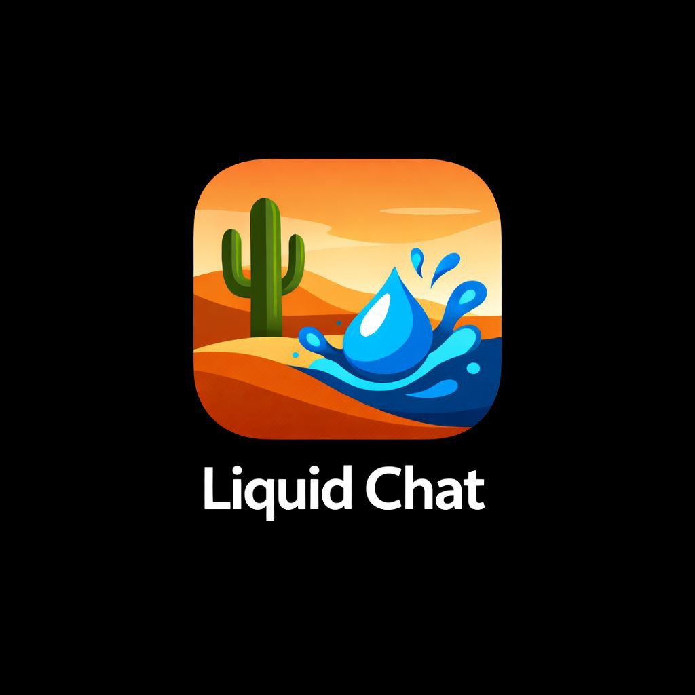
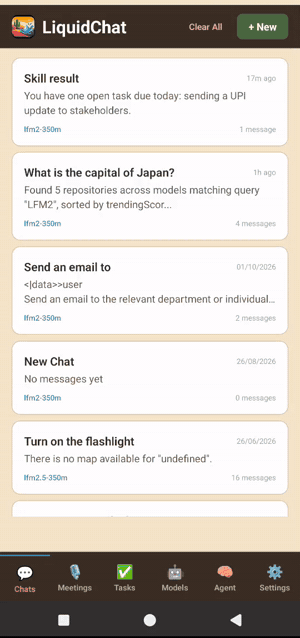

<p align="center">
  
</p>

<h1 align="center">LiquidChat</h1>

<p align="center">
  <b>A personal agent that lives on your phone.</b><br/>
  Liquid AI's LFM2.5 models chat, plan, use tools, transcribe meetings and remember things on the device, with no cloud account needed.
</p>

<p align="center">
  <a href="https://www.liquid.ai"></a>
  <a href="https://github.com/cactus-compute/cactus"></a>
  <a href="https://huggingface.co/spaces/kshitijthakkar/LiquidChat"></a>
  <a href="https://www.npmjs.com/package/@traceverse/genai-otel-instrument-node"></a>
  
  <a href="https://github.com/Mandark-droid/LiquidChat/releases/latest"></a>
</p>

<p align="center">
  
  <br/>
  <sub>On a Nothing Phone 2a (sped up): chat on LFM2.5-350M → a tool request routed to LFM2.5-1.2B → a 5-speaker meeting with owners → a skill created from one sentence → the agent dashboard.</sub>
</p>

---

## Why LiquidChat

Most "AI assistants" are a thin client over someone else's GPU. LiquidChat shows how far a phone can go on its own with small, fast foundation models:

- **Private by default.** Chat, tool calls, meeting audio, transcripts, memory and documents stay on the phone. Nothing leaves unless you configure a destination and allow it.
- **Fast enough to feel native.** LFM2.5-350M answers casual chat with the first token in about a second. LFM2.5-1.2B handles tool calls and planning. A router picks the model for each step.
- **It does things.** The phone runs 35+ real Android actions (flashlight, alarms, DnD, Bluetooth, calendar, contacts, settings, UI automation) behind a permission gateway.
- **Bigger models only when you choose them.** For long meetings or hard questions, the free [LiquidChat Hugging Face Space](https://huggingface.co/spaces/kshitijthakkar/LiquidChat) runs on *your* ZeroGPU quota. Anyone who forks the app can do the same.
- **You can see every step.** Every model call, agent run, tool, MCP call, retrieval and meeting can be exported as OpenTelemetry spans to your own backend.

## Get started in two minutes

1. Download the APK from the [latest release](https://github.com/Mandark-droid/LiquidChat/releases/latest) (or `release/LiquidChat.apk`) and install it on Android 7+.
2. Open **Models** and download **LFM2.5-350M** and **LFM2.5-1.2B-Instruct**. The download is about 1 GB on Wi-Fi.
3. Start a chat. Try *"Turn on the flashlight"*, *"Remember that I prefer meetings at 11 am"*, or *"Search Hugging Face for LFM2 models"*.
4. Optional: open **Meetings → ⏺** and record your next meeting.

## What it can do

### Chat and agent
- **Streaming on-device chat** with live tokens, tokens/s and time to first token.
- **Per-step model routing.** Chat stays on LFM2.5-350M. Tools, planning and structured output go to LFM2.5-1.2B-Instruct. With your approval, a single hard reasoning step can go to a cloud model you configured (Anthropic, OpenAI-compatible, Gemini, or the LiquidChat Space). Routing considers battery, heat and RAM.
- **Multi-step agent runtime.**
  - Plans are validated, run through a permission gateway, verified (DnD is read back after enabling it) and retried.
  - Runs can be cancelled, and they resume after the app is killed without repeating a send.
  - Each step is shown in the chat: the goal, 🔧 tools with their arguments, 🧠 reasoning, ✓/✗ and the result.
- **Skills and routines.** Five built-in skills: meeting prep, morning brief, focus mode, meeting follow-up and end of day. You can also describe a new one in a sentence. Skills are declarative and cannot run code.
- **MCP servers.** The read-only Hugging Face MCP server is preinstalled. Add any other server in Agent settings.

### Meetings
- **Record, upload or share audio.** A foreground service records 16 kHz audio and transcribes it while the meeting is still going, with Whisper, Parakeet TDT v3 or Moonshine. Language is auto-detected (good with Hindi/English code-switching) and translated to English by default.
- **Speakers and owners.** Voice fingerprints separate speakers. Names come from introductions. Action-item owners come from who actually said "I'll…".
- **Client-ready minutes.** Summary, decisions, open questions, next steps and action items with real due dates. Export as PDF, Word, Markdown or text, or email them to attendees.
- **High-accuracy mode on the LiquidChat Space** (optional, free with your HF token): Silero VAD + WeSpeaker diarization, Whisper per speaker turn, and Gemma 4 12B for the minutes. A 52-minute Hinglish meeting takes about 5 minutes. If the Space is unavailable, processing falls back to the phone. Source is in [`space/`](space/).
- **Ask about a meeting.** Answers come from the minutes and the passages that match your question.

### Memory and documents
- *"Remember that…"* saves a memory immediately. Replies draw on saved memories, similar past conversations, and passages from imported documents and meetings, all embedded on the device with Qwen3-Embedding-0.6B.
- Indexing runs in the background with capped stores and least-recently-used eviction. Deleting a meeting removes it from the index.
- The embedding model loads only when it fits next to the chat models and is released when idle, so memory never pushes the app over its RAM budget.

### Tasks, email and the rest
- **Tasks:** one list for your to-dos and every meeting's action items, with natural-language quick add (`send Acme proposal by Friday !high @Acme`).
- **Email drafter:** follow-ups, new emails and replies, with a tone you choose.
- **Agent Insights:** completion, routing, latency, cost, and **Kept on this phone**, which counts tokens processed on-device versus sent to the cloud and the cost avoided.

## The models

| Role | Model | Where it runs |
|---|---|---|
| Chat | [LFM2.5-350M](https://huggingface.co/LiquidAI/LFM2.5-350M) | Phone (always loaded) |
| Tools, planning, structured output | [LFM2.5-1.2B-Instruct](https://huggingface.co/LiquidAI/LFM2.5-1.2B-Instruct) | Phone (always loaded) |
| Mobile-actions fine-tune | [LFM2.5-1.2B-Instruct-mobile-actions](https://huggingface.co/kshitijthakkar/LFM2.5-1.2B-Instruct-mobile-actions) | Phone |
| Reasoning, vision, larger chat | LFM2.5-1.2B-Thinking, LFM2-VL-450M, LFM2.5-VL-1.6B, LFM2-2.6B, LFM2-8B-A1B | Phone, loaded on demand |
| Speech to text | Whisper (small/medium), Parakeet TDT v3, Moonshine | Phone |
| Embeddings | Qwen3-Embedding-0.6B | Phone, loaded per use |
| Diarization, long-form ASR, minutes | Silero VAD, WeSpeaker, Whisper large-v3 / Hinglish fine-tune, Gemma 4 12B | LiquidChat Space (optional) |

All on-device models run on the [Cactus](https://github.com/cactus-compute/cactus) engine (INT4/INT8). The prompt window is raised to 4,096 tokens.

`ModelLifecycleManager` keeps the two LFM2.5 models resident and loads everything else on demand. It evicts least-recently-used models to stay within a RAM budget it picks for each device class.

**Fine-tuning.** The mobile-actions model was trained with LoRA (r=16, α=16) via Unsloth on Hugging Face Jobs, using [31,550 examples](https://huggingface.co/datasets/kshitijthakkar/liquidchat-lora-dataset). Three Claude Code skills in `.claude/skills/` automate the loop from training to the Cactus format to the APK: `/unsloth-jobs-training`, `/lora-to-cactus-hub` and `/build-apk-liquidchat`. Chats can be exported as JSONL datasets to feed the next round.

LFM3 will be added as soon as Cactus can run it.

## Observability with OpenTelemetry

LiquidChat exports traces and metrics over **OTLP/HTTP** using [`@traceverse/genai-otel-instrument-node`](https://www.npmjs.com/package/@traceverse/genai-otel-instrument-node) ([docs](https://mandark-droid.github.io/genai-otel-instrument-node-docs/)). Spans follow the OpenTelemetry GenAI semantic conventions, so any OTLP backend can read them. Export is **off by default**.

### What gets traced

| Span | What it covers |
|---|---|
| `cactus.complete`, `cactus.embed`, `cactus.stt.transcribe`, `cactus.init`, `cactus.download` | Every on-device model call: tokens, time to first token, decode speed, memory, tool calls |
| `invoke_agent liquidchat` / `invoke_agent skill:<name>` | One agent run or skill, the parent of its steps |
| `execute_tool <tool>` | A tool call through the permission gateway; MCP calls carry `mcp.server.name` |
| `retrieve memory`, `retrieve chat_context`, `retrieve` | Memory, chat-context and meeting retrieval |
| `query <store>` | Vector-store searches with `rag.result.score_max/min/mean/margin` |
| `hf_space <api>` | Calls to the LiquidChat Space |
| `meeting.process`, `meeting.process_space` | The meeting pipeline, on the phone or on the Space |
| Remote model calls | Cloud and Space chat calls, with the same token and cost attributes |

Prompts, replies, tool arguments and results, and transcripts are attached **only** when *Include prompts and replies* is on. Error messages follow the same rule; otherwise only the error type is sent.

### Settings → OpenTelemetry Export

| Field | What to enter |
|---|---|
| **Export telemetry** | On to start exporting |
| **Collector URL** | The OTLP/HTTP base URL. The app adds `/v1/traces` and `/v1/metrics`. Use `https://`; plain `http://` is accepted only for a collector on your local network. |
| **Headers** | Comma-separated `key=value` pairs (the `OTEL_EXPORTER_OTLP_HEADERS` format). Stored in Android Keystore-encrypted storage; the field shows only `•••• saved` afterwards. |
| **Include prompts and replies** | Adds message text, tool I/O and transcripts to spans |
| **Send now** / **Save** | Flush buffered telemetry immediately / apply the settings |

The app also flushes whenever it goes to the background.

### Route 1: your own OpenTelemetry Collector (standard OTLP)

Any collector with the OTLP/HTTP receiver works:

```yaml
# otel-collector config
receivers:
  otlp:
    protocols:
      http:
        endpoint: 0.0.0.0:4318
exporters:
  otlp/jaeger:
    endpoint: jaeger:4317
    tls: { insecure: true }
service:
  pipelines:
    traces: { receivers: [otlp], exporters: [otlp/jaeger] }
```

In the app:

- **Collector URL:** `https://otel.example.com` (or `http://192.168.1.20:4318` on your Wi-Fi)
- **Headers:** whatever your collector requires, e.g. `Authorization=Bearer <token>`, or leave empty

**Reaching a private collector from a phone on mobile data.** We test with a tunnel in front of a reverse proxy:

```
phone ──https──▶ ngrok tunnel ──▶ nginx :9099 ──▶ HAProxy :443 ──▶ collector :4318 ──▶ Jaeger
```

If the same proxy also serves a web UI, route the OTLP paths to the collector *before* the catch-all `location /`. Otherwise `/v1/traces` is answered by the UI (typically a redirect to a sign-in page):

```nginx
location ~ ^/v1/(traces|metrics|logs)$ {
    proxy_pass http://127.0.0.1:4318;   # or the TLS front door that forwards to the collector
    client_max_body_size 32m;
}
```

Check the route with `curl -X POST -H 'Content-Type: application/json' -d '{"resourceSpans":[]}' https://<your-host>/v1/traces`. It should return `200`. Over USB, `adb reverse tcp:4318 tcp:4318` lets `http://localhost:4318` on the phone reach a collector on your computer.

### Route 2: Arize (SaaS)

Arize accepts OTLP/HTTP directly:

| Field | Value |
|---|---|
| **Collector URL** | `https://otlp.arize.com` |
| **Headers** | `space_id=<your Arize space ID>,api_key=<your Arize API key>` |
| **Include prompts and replies** | On, if you want the content in Arize |

Both values are in Arize under **Settings → API Keys** (the space ID is also in the space URL). They are saved encrypted on the phone and never written to logs or spans.

Arize files every trace under a **project** and rejects traces that don't name one (`HTTP 400: trace export requires project routing`). For an Arize endpoint, LiquidChat adds `x-project-name=liquidchat` automatically. To use a different project, add your own `x-project-name=<project>` to the headers.

Arize classifies spans by the OpenInference attribute `openinference.span.kind`. Every span LiquidChat exports carries it next to the GenAI attributes (`AGENT`, `TOOL`, `LLM` for completions and transcription, `EMBEDDING`, `RETRIEVER`, `CHAIN` for pipelines and model loads), along with `llm.model_name`, `llm.token_count.*`, `input.value` and `output.value`. Without these, Arize shows the span kind as *unknown*.

To check your keys from a computer before configuring the phone:

```bash
curl -s -w ' %{http_code}\n' https://otlp.arize.com/v1/traces \
  -H "space_id: $ARIZE_SPACE_ID" -H "api_key: $ARIZE_API_KEY" \
  -H 'x-project-name: liquidchat' -H 'Content-Type: application/json' \
  -d '{"resourceSpans":[]}'
# → {} 200
```

The app sends to one destination at a time. To fan out to several backends (Arize *and* your Jaeger, say), point the app at your collector and add an exporter per backend there.

## Privacy and security

- Only data you mark as public may leave the phone by default. Sending personal data to a cloud model needs your privacy policy to allow it *and* a first-time approval per provider. Notification content never leaves the phone.
- Anything sensitive asks first, and sending is never "always allowed". Retrieved text can never trigger a tool.
- API keys and telemetry headers live in Keystore-encrypted storage. The agent database is SQLCipher-encrypted.
- The LiquidChat Space keeps nothing and uses only open, ungated models. Its GPU time is charged to the caller's own HF token.

## Architecture

```
src/
├── agent/          Planner, executor, verifier, state machine, plan validation
├── inference/      Model router, routing policy, cloud providers (incl. LiquidChat Space), cost ledger
├── services/       Model lifecycle (RAM budget, eviction), memory + vector store, HF Space client
├── tools/          35+ native tools and the permission gateway
├── mcp/            MCP client, server store, tool adapter
├── skills/         Skill registry, generator, validator, built-in skills
├── meetings/       Recorder session, transcriber, speaker ID, minutes, documents, Space pipeline
├── memory/         Retrieval, auto-indexing, chat context
├── observability/  OpenTelemetry export and spans, insights, usage ledger, evaluation set
├── security/       Approvals
├── storage/        Encrypted agent database
└── screens/, components/
space/              The LiquidChat Hugging Face Space (Gradio, ZeroGPU)
android/            Native modules: system controls, accessibility service, audio/meeting docs
docs/               Agent runtime, Android layer and spec
```

More detail: [`docs/agent-runtime.md`](docs/agent-runtime.md), [`docs/android-native.md`](docs/android-native.md), [`docs/spec/`](docs/spec/).

## Build from source

Prerequisites: Node.js 20+, JDK 17+, Android SDK with NDK 27.1.12297006, and `ANDROID_HOME` set.

```bash
npm install
npm run android                     # debug build on a connected device
npm run check                       # TypeScript (strict), ESLint, Prettier, Jest

# Release APKs: `full` (sideload, includes UI automation) or `play` (Play Store policy-safe)
cd android && ./gradlew assembleFullRelease -PreactNativeArchitectures=arm64-v8a
```

The APK is written to `android/app/build/outputs/apk/full/release/app-full-release.apk`. Release builds are signed with the debug keystore, which is fine for sideloading; add your own keystore before publishing.

CI runs `npm run check`, debug builds of both flavors and Android lint.

## Release history

| Version | Highlights |
|---|---|
| **v1.2** | LiquidChat Space for meetings and larger models, audio export, Q&A that works on real meetings, visible agent plans, memory and RAG with auto-indexing and limits, a 4K prompt window, the *Kept on this phone* insight, OpenTelemetry export |
| **v1.1** | Streaming chat, task-based routing, Hugging Face MCP, skills from one sentence, speaker identification, upload/share recordings, auto language detection |
| **v1.0** | Agent runtime with permissions, meetings, tasks, email drafter, memory, skills |
| **v0.x** | LoRA-tuned LFM2.5-1.2B turning requests into native Android actions |

## What's next

- **LFM3** on the device, once the Cactus engine supports it.
- **iOS parity:** native modules and Shortcuts integration.
- Retraining the mobile-actions LoRA on the expanded tool set and on exported real conversations.

## Acknowledgements

Built on [Liquid AI](https://www.liquid.ai) LFM models, the [Cactus](https://github.com/cactus-compute/cactus) on-device engine, [Hugging Face](https://huggingface.co) (Hub, Spaces, ZeroGPU, Jobs) and [OpenTelemetry](https://opentelemetry.io).

## License

For research and testing. The model weights are subject to their own licenses, including Liquid AI's LFM license.

## Author

**Kshitij Thakkar**: [github.com/Mandark-droid](https://github.com/Mandark-droid) · [huggingface.co/kshitijthakkar](https://huggingface.co/kshitijthakkar)
